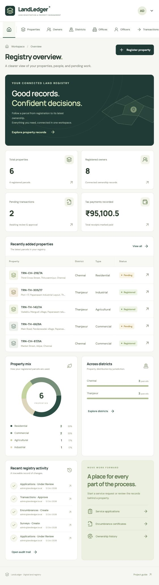

# LandLedger

A React web application for the **Digital Land Registration and Property Management System** DBMS project. Forms write to a real **CockroachDB** database; the dashboard and record views read from the same database.

## Included

- Home dashboard: parcel counts, owners, pending transactions, recorded tax receipts, property mix, district distribution and audit activity.
- Exactly **12 primary tabs**: Properties, Owners, Districts, Offices, Officers, Transactions, Documents, Surveys, Valuations, Tax Payments, Encumbrances and Mutations.
- Search, status filters, pagination, record details, entry forms and current-page CSV export.
- Initial registration, sale, inheritance and gift transactions with joint ownership shares and dated ownership history.
- Deed uploads and verification; a sub-registrar approves transactions.
- Surveys, boundary updates, valuation history, tax receipt recording and encumbrance claims.
- Service applications, generated encumbrance-certificate snapshots, user accounts and an audit trail through the workspace menu.
- Two sign-in areas: **Department / administrator** and **Public user**. Visitors can create read-only public accounts; administrator and staff accounts are created only by signed-in administrators.
- Eight access roles: the seven existing department roles plus `public_viewer`, which can only search and view safe registered-property information.
- Serializable transaction retries, foreign keys, validation, protected finalized records, password hashing and HTTP-only session cookies.
- Separate interactive **ER diagram** tab: 18 tables and 37 foreign-key relationships read from the live database, with draggable tables, cardinalities, column/constraint inspection, related-table filtering and JSON export.



This is a student demonstration application. It does not perform real tax payments, mortgage approvals or legal registration. All seeded records and example documents are fictional. Amounts use INR; land areas use square metres.

## Stack

- React + TypeScript + Vite
- Node.js 22 + Express
- CockroachDB 25.4.0, with the `pg` PostgreSQL-compatible driver
- Local private file storage for documents; document metadata/checksums are in CockroachDB

## Run locally

Requirements: **Node.js 22.19+**, npm, and either Docker Compose or an installed CockroachDB binary. Node 24 is also suitable. The versioned Docker configuration provides the tested database version.

```sh
git clone https://github.com/Sai-2211/dbms_project.git
cd dbms_project
npm ci
npm run setup
docker compose up -d
```

Wait for the database to become healthy and the `db-init` service to exit successfully:

```sh
docker compose ps -a
npm run db:migrate
npm run db:seed
npm run dev
```

Open **http://127.0.0.1:5173**. The API runs on port 3001; CockroachDB SQL uses port 26257. Its development DB console is available at http://127.0.0.1:8080.

`npm run setup` creates a private, ignored `.env` file with a random session secret. It preserves an existing `.env`. The default database URL is for a loopback-only, insecure **local demonstration** database. Database data persists in a Docker volume. Document files persist in the ignored `uploads/` directory.

### Without Docker

Use an official CockroachDB binary, then keep this process running:

```sh
cockroach start-single-node --insecure --listen-addr=127.0.0.1:26257 --http-addr=127.0.0.1:8080 --store=./work/cockroach-data
```

In another terminal:

```sh
cockroach sql --insecure --host=127.0.0.1:26257 --execute='CREATE DATABASE IF NOT EXISTS landledger;'
npm run db:migrate
npm run db:seed
npm run dev
```

### Demo sign-in

All seven seeded accounts use **`LandLedger@2026`**, unless `DEMO_ADMIN_PASSWORD` was changed before the first seed.

| Username                     | Role                                                                       |
| ---------------------------- | -------------------------------------------------------------------------- |
| `admin@landledger.local`     | Administrator; all twelve modules                                          |
| `owner@landledger.local`     | Owner portal; own parcels and applications                                 |
| `registrar@landledger.local` | Sub-registrar for Chennai Central Registry                                 |
| `surveyor@landledger.local`  | Survey officer                                                             |
| `valuer@landledger.local`    | Valuation officer                                                          |
| `bank@landledger.local`      | Read-only ownership/encumbrance verification; private owner details hidden |
| `auditor@landledger.local`   | Read-only records and audit trail                                          |

The seed creates 24 fictional properties, nine owners, four districts and examples across the primary modules. Running it again leaves existing demonstration data unchanged. It refuses a non-empty database containing unrelated records and is disabled when `NODE_ENV=production`.

## Demonstrate the project

Start with [the step-by-step demo guide](docs/DEMO_GUIDE.md). It covers a new registration, a transfer, verification, joint ownership, rollback, role access and the ER explorer. The dashboard is populated from database queries, rather than hardcoded counts.

Read [the detailed architecture report](docs/ARCHITECTURE.md) for the frontend, backend, database connection and transfer workflow. [The verification report](docs/VERIFICATION_REPORT.md) contains all 79 passing test cases, security checks, browser evidence and practical limitations.

## Host on Render

### Render Free: after creating your Web Service

1. Select Node, branch `main`, and leave Root Directory empty. Use build command `npm ci --include=dev && npm run build`, start command `npm run start:render`, and health check `/api/health`.
2. Set `DATABASE_URL` to your private CockroachDB Cloud connection string for the intended database, with the actual SQL password and `sslmode=verify-full`. Set `SESSION_SECRET` to a random secret of at least 32 characters, `NODE_VERSION=22.x`, `NODE_ENV=production`, `HOST=0.0.0.0`, and `UPLOAD_DIR=uploads`. Render supplies its URL and port automatically. Do not copy your local `.env` wholesale or expose secrets through frontend variables.
3. In the Render service's **Connect → Outbound** menu, copy every IPv4 CIDR range. In CockroachDB Cloud, open the cluster's **Networking → IP Allowlist → Add Network**, choose **New Network**, paste each range separately, enable SQL/client access if prompted, and apply. This is the network authorization needed for Render to reach CockroachDB. The connection string is still required independently.
4. Add CockroachDB's **Current Network** entry too if you will run account setup from your Mac. After adding the required ranges, remove a broad `0.0.0.0/0` entry if present. Allow about 30 seconds for the change to take effect and retry the Render deployment if it previously failed to connect.
5. Open your service's `/api/health` URL. `{"status":"connected","database":"CockroachDB"}` confirms database connectivity. It does not mean an administrator account exists yet.
6. Follow [first administrator setup](docs/ACCOUNT_SETUP.md). In your local repository terminal, update the code with `git pull origin main`, install with `npm ci`, and run `npm run db:admin`. Privately enter the **same DATABASE_URL as Render**, then choose and confirm an application login password. Log in as `admin@landledger.local` using that password. To recover an existing administrator, use `npm run db:admin -- --reset-password` instead. This account is written directly to CockroachDB; no Render Shell is needed.

`DEMO_ADMIN_PASSWORD` does not create or update accounts merely by being set. The local administrator command creates only the administrator; it does not populate the registry with sample parcels or document references. Administrators create privileged accounts through **User accounts**. Visitors can use **Public user → Create account** to register read-only public accounts.

Render Free sleeps after inactivity and has no persistent disk or Shell access. With `UPLOAD_DIR=uploads`, uploaded files are temporary and can disappear after restarts, idle shutdowns or deployments even though SQL metadata remains. Persistent cloud document storage is a separate update, not implemented by the administrator setup command. CockroachDB records remain in the external database. See [the deployment guide](docs/RENDER_DEPLOYMENT.md) and [Render's Free limitations](https://render.com/docs/free).

### Optional paid deployment

The root `render.yaml` is a **paid Blueprint**, with a persistent document disk. Import it with **New → Blueprint** only if you want that paid configuration; it is not the setup for your existing Free service. See [the Render deployment guide](docs/RENDER_DEPLOYMENT.md) and review the displayed cost before creating resources.

Provide your private `DATABASE_URL` and a new private `DEMO_ADMIN_PASSWORD`. Render generates the session secret, and the app automatically uses the assigned HTTPS address. After deployment, run `npm run db:bootstrap-demo` in the Render Shell to initialize fictional records and accounts. The guide includes an alternative for an existing manually created Web Service. No cloud resources are created by committing these files.

## Schema approval

The supplied scan omitted entity attribute descriptions 4–7. The user approved reconstructing Offices, Officers, Transactions and Documents, adding foreign keys/validation, and adding six supporting tables. The approved design has **18 database tables** and **12 primary navigation tabs**. See [the retained approval proposal](docs/SCHEMA_APPROVAL.md) and [the ER diagram](docs/SCHEMA.md).

`server/schema.sql` creates the approved tables without dropping existing tables. `npm run db:migrate` also runs the approved, repeatable public-role upgrade for existing databases. This changes only the two `users` role/profile CHECK constraints and preserves records and passwords. Further schema changes require user approval.

## Administrator and public user login

Choose **Department / administrator** for existing staff/owner accounts and **Public user** for read-only public accounts. The selected button does not grant permissions: the server reads the account role from CockroachDB on every request.

Administrators use the top-right account menu → **User accounts → Add user account**, selecting **Public user · read-only**. These accounts can browse only registered properties, search safe fields, filter districts, open basic registration details. Location/address text, encumbrance indicators, owner identities/contact information, documents, financial records, pending/rejected properties, staff accounts, audits and the ER diagram are unavailable to them. Requests to editing endpoints are denied by the backend. Staff retain their existing permissions.

The schema update adds `public_viewer` to the existing `users` role/profile checks. No table, column or foreign key was added; the ER model remains **18 tables and 37 relationships**. `npm run db:migrate` creates the initial schema and runs the repeatable upgrade for existing databases, preserving records and passwords. Render applies this automatically with `npm run start:render`. See [the implementation notes](docs/PUBLIC_USER_ACCESS.md).

Visitors can also select **Public user → Create account**, enter a username and a password of 12–128 characters, and confirm the password. Signup opens the public portal automatically. The server fixes the role to `public_viewer`, rejects role/profile overrides, protects department usernames and limits signup attempts. Public responses and searches exclude locations and encumbrances; public bulk export is removed. This signup/privacy update makes **no schema changes**. See [the signup and privacy report](docs/PUBLIC_SIGNUP.md).

## Checks

```sh
npm test
npm run test:integration
npm run build
```

The integration tests require a reachable CockroachDB instance and a development SQL user allowed to create databases. Each run creates its own `landledger_test_*` databases and removes only those test databases afterward. The tests exercise all 37 foreign keys, full rollback, conflicting transfers, joint ownership, document checks, role access, status filters, SQL injection, escaped HTML, upload/download, certificates, surveys, live schema accuracy, Render proxy limits, private demo initialization, administrator creation/recovery, public-user privacy, login-area restrictions and repeatable role migration. The latest suites passed 25 unit and 54 integration tests. GitHub Actions repeats the checks on each push and pull request.

The application never substitutes SQLite, PostgreSQL, browser storage or mock data when CockroachDB is unavailable. The interface displays a connection or operation error.

### Serve the built app

```sh
npm run build
npm start
```

Open **http://127.0.0.1:3001**. The API serves the built frontend. Development mode allows this loopback origin as well as the Vite origin. `npm start` requires the project's installed dependencies because the backend runs TypeScript through `tsx`.

## Configuration

| Variable              | Purpose                                                                                         |
| --------------------- | ----------------------------------------------------------------------------------------------- |
| `DATABASE_URL`        | CockroachDB connection URL. Production requires `sslmode=verify-full`.                          |
| `SESSION_SECRET`      | Random signing secret, at least 32 characters. Never put it in frontend code.                   |
| `PORT`                | API port; default 3001.                                                                         |
| `HOST`                | API bind host; default `127.0.0.1` locally, `0.0.0.0` on Render.                                |
| `APP_ORIGIN`          | Exact frontend origin. Uses Render's assigned URL there; local default `http://127.0.0.1:5173`. |
| `UPLOAD_DIR`          | Persistent private document directory; default `uploads`.                                       |
| `DEMO_ADMIN_PASSWORD` | Sample-account password for first seed only. Render bootstrap requires a private value.         |
| `NODE_ENV`            | Set to `production` only with HTTPS, secure database credentials, and real accounts.            |

Uploaded files are PDF/PNG/JPEG, up to 10 MB, with a UUID storage key and SHA-256 checksum. Downloads require an authorized session. Finalized documents cannot be replaced. Keep both database backups and document-directory backups together.

## Project structure

```text
src/                  React interface and API client
server/schema.sql     Approved CockroachDB tables, constraints and indexes
server/index.ts       API routes, file handling and session authorization
server/business.ts    Ownership approval, validation and audit operations
server/resources.ts   Form metadata and module permissions
server/db.ts          Database connection and serializable retry wrapper
server/catalog.ts     Live column, key and relationship metadata for the ER tab
src/SchemaExplorer.tsx Interactive ER diagram and schema inspector
server/seed.ts        Fictional demonstration records
server/bootstrap-demo.ts Explicit Render Shell demo initialization
tests/                Unit and isolated database/API tests
docs/                 ER diagram, approval record and professor/demo guides
docker-compose.yml    Loopback-only persistent development CockroachDB
render.yaml           Render Web Service and private persistent document disk
```

## Scope and deployment limits

The single-node setup demonstrates relational integrity and atomic, serializable transactions. It **does not demonstrate node-failure resilience**; that needs a correctly configured multi-node deployment and a separate failover demonstration. See [the database justification](docs/DATABASE_JUSTIFICATION.md).

The audit trail is append-only through the application API. A database administrator can still modify database rows; it is not a cryptographically immutable legal ledger. Bank verification is a read-only view, not a lending decision. A certificate captures the claims currently stored for its requested period, including released claims that overlap the period; it does not certify the completeness of external government records.

Before public production use, configure TLS and least-privilege database credentials, replace demonstration accounts, establish backup/recovery and file retention, and review the application against the actual department's requirements. The public-user portal exposes only its explicit registered-property projection to read-only public accounts; private owner data and documents remain restricted.
