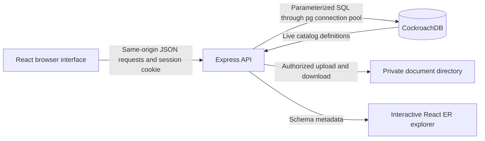

# LandLedger: architecture and implementation report

**Project:** Digital Land Registration and Property Management System\
**Updated:** 12 October 2026\
**Implementation:** current repository, including the public portal and controlled training import

LandLedger is a working course demonstration with a React interface, an Express backend, and a real CockroachDB database. Forms save persistent records, and the dashboard and record pages read those records back. The approved schema contains 18 tables: the 12 main entities plus six supporting tables. Home and the separate interactive ER diagram accompany the 12 main navigation tabs. The public-user update widens the two existing `users` CHECK constraints; the table and relationship model stays the same.

## 1. Architecture

The application uses a **three-tier architecture**. The frontend is a single-page application; the backend is a modular Express application; the database is the authoritative store for structured records. Private document files are stored separately, with their metadata in the database.

| Layer        | Technology                                                    | Responsibility                                                                                  |
| ------------ | ------------------------------------------------------------- | ----------------------------------------------------------------------------------------------- |
| Presentation | React 19, TypeScript, Vite, CSS, Lucide icons                 | Dashboard, forms, tables, details, role-aware controls and feedback                             |
| Application  | Node.js 22, Express 5                                         | Authentication, authorization, validation, ownership workflows, file handling and API responses |
| Persistence  | CockroachDB 25.4.0, `pg` driver                               | Tables, constraints, indexes, joins, aggregates and serializable transactions                   |
| Documents    | Private local directory, SHA-256 metadata                     | Digital copies retrieved through authorized API routes                                          |
| Diagram      | React Flow and CockroachDB catalogs                           | Interactive visualization of actual table definitions and foreign keys                          |
| Verification | Node test runner, TypeScript build, npm audit, GitHub Actions | Repeatable validation, database/API/security checks and build verification                      |

This is a modular application backend, rather than a collection of microservices. That keeps the project understandable and allows one transaction to control all changes in an ownership approval.

## 2. Why CockroachDB is appropriate

The main reason is the combination of **relational integrity and concurrent transactional registration workflows**. Properties, owners, offices, officers, deeds, payments and ownership history are strongly related. A transfer needs several related changes to succeed together.

CockroachDB supplies a SQL interface over a distributed storage and transaction architecture. That makes distributed SQL a defensible advanced technology for the multi-office departmental scenario. Its distribution and replication architecture are documented in the [official architecture overview](https://docs.cockroachlabs.com/docs/stable/architecture/overview).

In this implementation, the useful evidence is concrete: foreign keys reject missing records; a complete transfer commits related changes together; a deliberately induced late failure rolls everything back; and two concurrent sales cannot consume the same ownership twice. These are demonstrated on the installed CockroachDB instance.

The current local setup has one database node. It demonstrates SQL integrity and serializable transactions. It does not demonstrate multi-node replication, geographic locality or node-failure recovery. CockroachDB also introduces retry handling and more operational/licensing complexity than a conventional small relational deployment. [DATABASE_JUSTIFICATION.md](DATABASE_JUSTIFICATION.md) includes the comparison with the other suggested databases.

## 3. How the database connects to the application

`server/config.ts` reads server-side environment variables. `DATABASE_URL` selects the CockroachDB instance; `SESSION_SECRET` signs sessions; the remaining settings control ports, origin and private storage. These values are not embedded in React code. The actual `.env`, uploaded files and database data are ignored by Git.

`server/db.ts` constructs a `pg.Pool` with at most ten connections and a five-second connection timeout. CockroachDB supports the PostgreSQL wire protocol, so the PostgreSQL-compatible driver can send SQL to CockroachDB. This does not make the database PostgreSQL: the health check reads `version()` and verifies that the server identifies itself as CockroachDB.

During development:

1. The browser loads the React app from `http://127.0.0.1:5173`.
2. It requests relative `/api/...` URLs.
3. Vite forwards those API requests to Express on `127.0.0.1:3001`.
4. Express authenticates the session and validates the request.
5. The connection pool sends parameterized SQL to CockroachDB on port 26257.
6. Express returns JSON. React updates the form, record listing or dashboard.

For the built application, Express serves the files generated in `dist/` as well as `/api` from one origin. `npm run build` checks TypeScript and creates the frontend bundle; `npm start` runs the backend with its installed TypeScript runtime. The standalone built-app smoke check verified HTML, its JavaScript bundle, authentication, database connectivity and live schema metadata.

`server/migrate.ts` creates the approved tables using `server/schema.sql`. It then runs `server/upgrade-public-role.ts`, which validates the replacement account checks before removing the legacy checks. It does not drop existing application tables or change their rows. `server/seed.ts` adds explicitly fictional demonstration data and refuses unrelated nonempty databases. There is no automatic browser-storage or alternative-database fallback when CockroachDB is disconnected.

## 4. Database model

| Main table     | Meaning and important links                                              |
| -------------- | ------------------------------------------------------------------------ |
| `properties`   | Parcel details, type, area, boundaries, district and registration office |
| `owners`       | Owner profiles and unique identification numbers                         |
| `districts`    | Administrative districts; state/district pair is unique                  |
| `offices`      | Registration offices belonging to a district; unique office code         |
| `officers`     | Designated officers belonging to an office                               |
| `transactions` | Registration, sale, inheritance and gift workflows for a property        |
| `documents`    | Deed/legal-document metadata, optional transaction and verifier          |
| `surveys`      | Dated survey measurements, property and conducting officer               |
| `valuations`   | Dated assessments, property and valuation officer                        |
| `tax_payments` | Recorded receipts, property and payer owner                              |
| `encumbrances` | Mortgage, lien, dispute or other claim; optional supporting document     |
| `mutations`    | Ownership changes, boundary updates or corrections awaiting review       |

| Supporting table      | Why it exists                                                      |
| --------------------- | ------------------------------------------------------------------ |
| `ownerships`          | Many-to-many owner/property relationship, shares and dated history |
| `transaction_parties` | Multiple transferors/transferees and their transferred shares      |
| `users`               | Login accounts with roles and linked owner/officer profiles        |
| `audit_events`        | Who changed or approved a record and when                          |
| `applications`        | Online service submissions and related workflow                    |
| `certificates`        | Issued encumbrance-certificate snapshots for a requested period    |

All 18 tables have UUID primary keys. The implemented schema has **37 foreign-key constraints**. Historical relationships use ordinary restrictive foreign keys; a deletion cannot silently cascade through legal history.

Money uses `DECIMAL(18,2)`, area uses `DECIMAL(18,4)`, and ownership shares use `DECIMAL(9,8)`. The API rejects excess precision rather than silently rounding. `decimal.js` performs share arithmetic during approval. The interface displays money to the stored two-decimal precision, with INR formatting; areas are in square metres.

Single-row rules belong in database constraints where appropriate: valid statuses/types, positive area/payment amounts, valid share ranges, approval-field combinations and date ordering. Cross-row rules, such as the total current ownership equalling 100%, are checked inside the controlled serializable approval workflow. A partial unique index prevents multiple current holdings for the same property/owner pair.

Ownership history uses an inclusive `valid_from` and exclusive `valid_to`. A null end date means the holding is current. Multiple records are intentional: previous ownership remains available after a transfer. Survey numbers are readable identifiers and are not globally unique keys; the approved model does not contain a normalized village/tehsil cadastral identifier or automatic physical-parcel deduplication.

## 5. Frontend implementation

`src/App.tsx` contains the login screen, workspace, dashboard, record browser and drawers. `src/PublicPortal.tsx` supplies the separate registered-property directory for public accounts. `src/api.ts` centralizes requests and error handling. `src/styles.css` provides the responsive interface; fonts are installed locally so the interface does not depend on an external font service.

The Home dashboard uses database queries for property totals, registered properties, owners, pending transactions, recorded tax totals, type distribution, district distribution, recent properties and audit activity. The decorative parcel illustration is illustrative, rather than a geographic survey map.

The 12 primary tabs keep entry forms and records organized by entity. Each page supports search, relevant status filtering, pagination, record details, refresh and current-page CSV export. Foreign keys display readable labels instead of raw UUIDs wherever lookup labels are available. Forms show required fields, typed controls and validation feedback.

The API provides trusted field metadata and the current user's write permissions. React builds the matching controls from that metadata. Related dropdowns filter offices by district, transactions/documents by selected property, and officers by designation and relevant office. Reviewers are restricted to the property's registration office. The backend independently repeats the checks; hiding a control is not the authorization boundary.

Property details bring together ownership, transactions, surveys, valuations, documents, claims, payments and mutations. Transaction details show parties and documents, letting the user add the records needed for approval. Supporting applications, certificates, ownership history and audits are accessible through workspace tools, with administrator account creation in its own drawer.

After a successful write, the app refreshes the relevant records, dashboard and lookup metadata. Data is retrieved again on a page reload. Loading, empty, validation and connection-error states are visible. Drawers support Escape and focus containment. Status is expressed in text as well as color. CSV cells are quoted and formula-like values are neutralized before export.

The diagram is loaded separately so its library is not part of the main interface's initial component load. The production build separates the app, React, icons and diagram code into chunks.

## 6. Backend implementation

The backend is split by responsibility:

| File                   | Responsibility                                                              |
| ---------------------- | --------------------------------------------------------------------------- |
| `server/index.ts`      | Routes, middleware, record operations, review endpoints, accounts and files |
| `server/resources.ts`  | Server-owned table/field metadata and module-level permissions              |
| `server/validation.ts` | Primitive types, required fields, lengths, decimals, dates, UUIDs and enums |
| `server/access.ts`     | Record-level access predicates and private-field redaction                  |
| `server/auth.ts`       | Password hashing, session signatures, cookies and account lookup            |
| `server/business.ts`   | Relationship checks, approval, ownership history, survey updates and audits |
| `server/db.ts`         | Connection pooling and complete serializable transaction retries            |
| `server/catalog.ts`    | Live ER/schema metadata extraction                                          |

Important endpoints include `/api/auth/login`, `/api/auth/me`, `/api/dashboard`, `/api/metadata`, `/api/lookups/:key`, `/api/records/:key`, `/api/records/:key/:id/review`, `/api/documents/:id/file`, `/api/accounts` and `/api/schema`.

The generic record endpoints only accept resources and writable fields present in the server's whitelist. Requests cannot supply arbitrary table names, column names, approval statuses or verification fields. SQL values are sent separately through placeholders. Record IDs and reference IDs must be valid UUIDs.

Owner access is restricted to current holdings and properties associated with that owner's applications. Unrelated record IDs receive an inaccessible/not-found response. Bank verification has a limited read-only set of modules, and private owner identifiers/contact information are removed. Searches also respect those privacy restrictions so a hidden value cannot be inferred by searching for it.

| Role              | Main permitted activity                                                                    |
| ----------------- | ------------------------------------------------------------------------------------------ |
| Administrator     | Manage primary records, create accounts and choose the proper active registrar for reviews |
| Owner             | Submit accessible parcels, transactions, documents, parties and service applications       |
| Survey officer    | Record surveys using the linked active survey profile and matching office                  |
| Valuation officer | Record valuations using the linked active valuation profile and matching office            |
| Sub-registrar     | Review documents, transactions and services within the applicable office                   |
| Bank verifier     | Read permitted ownership/claim records with private owner fields hidden                    |
| Auditor           | Read records and audit activity; no record writes                                          |
| Public user       | Read only the explicit registered-property projection in `/api/public/*`                   |

Finalized transactions, documents, completed surveys, valuations, paid receipts, released claims, completed applications/mutations and certificates are protected from ordinary edits/deletions. Registered parcel maintenance uses controlled survey and mutation workflows. Ownerships and audits cannot be directly written through the generic public record endpoints.

## 7. Atomic ownership registration and transfer

Approval is the most important database operation in the project. Its sequence is:

1. Verify the actor's role and active sub-registrar profile.
2. Lock the pending transaction and the property; check the registration office.
3. Require an uploaded, verified matching deed and verification of every attached document.
4. Reject active mortgages, liens and disputes that prevent transfer.
5. Read the current holdings and transaction parties.
6. For initial registration, require transferee shares totalling exactly one, with no transferor or existing registered ownership.
7. For a sale, gift or inheritance, require equal outgoing/incoming shares, sufficient current holdings, different transferor/transferee identities, and valid chronology.
8. Close the affected old holding periods and insert the resulting current holdings. Unaffected co-owners retain their periods.
9. Approve the transaction; register an initial parcel or create a pending ownership-change mutation for a transfer.
10. Complete open linked applications and insert the audit event.
11. Commit all database changes together.

For example, transferring 0.25 of a wholly owned property leaves 0.75 with the seller and gives 0.25 to the recipient. The earlier 1.0 holding remains in history.

The database operation runs at `SERIALIZABLE` isolation. When CockroachDB returns SQLSTATE `40001`, the wrapper rolls back and reruns the complete operation with fresh reads, up to five attempts with a short increasing delay and jitter. It does not retry only the last failed statement. The concurrent-sales test verifies that only one conflicting sale succeeds; the late-audit-failure test verifies that no earlier ownership updates remain after failure.

## 8. Other controlled workflows

A completed survey retains its own measurement and updates the current parcel area/boundary only if it is not older than another completed survey. An older historical survey therefore cannot replace the latest boundary. Valuations remain dated history.

An owner property submission creates an application. Submitting its registration transaction links the open application rather than creating a duplicate. A rejected transaction also rejects its open linked applications.

Certificate issuance validates the property, period, issuer and optional application. It snapshots all claims overlapping the requested period, including released historical claims. The issued snapshot remains unchanged when later claims change. A finalized application cannot be reused or overwritten by a new certificate. An ownership mutation requires an approved related ownership transaction; other mutation types record the described administrative change for review. Mutation descriptions do not independently parse and rewrite arbitrary parcel fields.

Tax entries record receipt/payment information in the project database. They do not contact a payment gateway. A payer need not be the current owner; payments may be recorded on someone's behalf.

## 9. Digital documents

Files are limited to 10 MB and accepted as PDF, PNG or JPEG based on their leading byte signatures. Accepted files receive generated UUID storage names; user-supplied filenames do not determine storage paths. The database stores the original filename, MIME type, size, SHA-256 checksum and private key.

Uploads require an authenticated permitted actor, an accessible pending document and, when linked, a pending transaction. Failed database writes remove the newly staged file. Replacing a pending file removes the previous copy only when no other document still references it. This protects the shared fictional sample file as well as other shared references.

Downloads recheck record access, return an attachment with `nosniff`, and never serve the upload directory as public static content. Verified/rejected documents cannot be replaced.

The file directory and SQL database are separate persistence systems. They do not form a single crash-atomic transaction: a process crash between file staging and SQL commit can leave an orphan file. Signatures and checksums do not constitute full format validation or malware scanning. Coordinated backup/restore and retention are required for a production document store.

## 10. Interactive ER diagram correctness

The separate department **ER diagram** tab reads `/api/schema` after authentication; public users are denied this endpoint. The backend reads real column definitions, primary/unique keys, foreign keys, nullability and referential actions from CockroachDB catalogs, plus `SHOW CONSTRAINTS` and `SHOW CREATE TABLE`. CockroachDB documents these system views in its [information-schema reference](https://docs.cockroachlabs.com/docs/stable/information-schema).

Each entity is a real table. Nodes display key attributes; selecting an entity shows all attributes, data types, nullability, defaults, constraints and table SQL/indexes. There are 18 nodes and 37 relationships. Users can drag nodes, pan, zoom, fit the view, reset the layout, focus on a table, inspect its neighbours, refresh definitions and export schema JSON. The interaction uses [React Flow](https://reactflow.dev/learn).

Arrows go from a child foreign key to the referenced parent key. Each child has one parent when its FK is required, or zero/one when nullable. Each parent has zero to many children unless an unconditional unique constraint on the FK imposes a one-child maximum. Every implemented FK currently has a many-child maximum. A partial active-ownership uniqueness index does not imply a globally one-to-one historical relationship.

Conditional rules such as an approved transaction requiring an approving officer are visible as database checks; nullable FK notation alone does not express the entire workflow. Roles and property types are attributes, so the diagram does not invent an EER inheritance hierarchy that the schema does not implement. The many-to-many owner/property association is correctly resolved through `ownerships`; transaction participants have their separate junction table.

The automated comparison checks every foreign-key endpoint and nullable flag against the approved executable SQL. A second test deliberately substitutes a nonexistent parent for each of the 37 foreign keys and confirms database rejection. The diagram is therefore based on the actual implemented structure rather than a manually drawn approximation.

## 11. Verification and practical limits

The latest local results are **25 unit tests and 58 CockroachDB/API integration tests passed**, with no skipped tests, including Render deployment and administrator access follow-ups. TypeScript checking and the production frontend build passed. npm's advisory audit reported zero known vulnerabilities in the installed dependency set at verification time. The original browser check covered all 12 record tabs, persistent entry, Unicode, escaped stored HTML, dependent dropdowns, pagination, status filtering, details and ER interactions/export. See [VERIFICATION_REPORT.md](VERIFICATION_REPORT.md) for the evidence and test inventory.

These checks provide broad repeatable coverage of representative inputs and security paths. They do not prove the absence of every possible vulnerability. The tested runtime was a local single-node CockroachDB instance on macOS with Node 22. The Docker Compose definition was checked for configuration validity; its local containers were not run because the local Docker daemon was unavailable. [GitHub Actions passed independently on Linux](https://github.com/Sai-2211/dbms_project/actions/runs/38046599242), using the versioned CockroachDB Docker image for the database checks.

The course prototype has no real government identity/deed verification, payment or lending integration, cadastral GIS, automated fraud classification, password-reset/MFA flow or legal certificate issuance. Account creation is available; password changes/account lifecycle management would need further application work. Audit records are append-only through the API but can be modified by a privileged database administrator. Sessions are signed and expire after eight hours; logout clears the browser cookie and does not provide individual stolen-token revocation. Rate-limit counters are held in one API process, not a shared distributed store. Reference dropdowns return up to 1,000 authorized records.

The app is deployed on Render with CockroachDB Cloud, and its authorized training import and document download were checked. The local root/insecure database remains a loopback-only demonstration. Real departmental use still requires least-privilege credentials, coordinated backups and operational review; multi-node failover and production-scale load tests have not been demonstrated. Future schema changes require project-owner approval.

### Render deployment configuration

For Render Free, `npm run db:admin` is an interactive local CLI: the operator privately supplies the exact cloud database URL and chooses an application password. It creates only the fixed administrator identity in the existing `users` table and records creation in `audit_events`. Existing passwords are preserved unless the explicit `--reset-password` flag is used. It performs no public signup, schema migration or fictional document seeding. Administrator/staff account creation stays administrator-only; visitors can self-register read-only accounts using the separate public signup route. [ACCOUNT_SETUP.md](ACCOUNT_SETUP.md) explains first-login and recovery steps; free document persistence still requires a separate cloud-storage implementation.

The root `render.yaml` defines a single Node Web Service. Render builds React with Vite; `npm run start:render` applies the approved schema and repeatable public-role upgrade, then starts the same Express application. The browser uses relative `/api` URLs, so the frontend and backend share the assigned HTTPS origin without a separate frontend server or public database credentials.

On Render, configuration defaults to its `RENDER_EXTERNAL_URL`, `0.0.0.0` and its injected `PORT`. A custom `APP_ORIGIN` overrides the assigned origin. Production startup requires HTTPS and a database URL using `sslmode=verify-full`. Express trusts one Render ingress hop for per-client rate limiting; local operation continues to reject proxy headers as a source of client identity.

CockroachDB Cloud remains an external database. A paid persistent disk mounted at `/var/data` holds private uploads under `/var/data/uploads`; SQL rows hold the document metadata. The explicit `db:bootstrap-demo` Shell command requires a private first-seed password and retains the protections against overwriting an existing registry. Normal production startup never seeds accounts automatically. See [RENDER_DEPLOYMENT.md](RENDER_DEPLOYMENT.md) for the exact settings, initialization steps and deployment limitations. The hosted training import was separately authorized and verified on 12 October 2026; normal startup does not automatically populate a registry.

## 12. Explanation for the professor

“We used a three-tier React, Express and CockroachDB architecture. React collects and displays the records, Express validates and authorizes each operation, and CockroachDB stores the related data. We chose advanced distributed SQL because land registration has strongly related records and concurrent workflows across offices. Our main demonstration is a serializable, atomic ownership transfer: old holdings, new shares, approval, mutation and audit changes succeed together or roll back together. We also verify conflicting sales, foreign keys and role restrictions. The administrator-only interactive ER tab reads the actual database schema. Our single-node demonstration proves the implemented integrity and transaction behaviour; distributed failover would require a separate multi-node test.”

## Public-user portal implementation

Two login choices send `portal=department` or `portal=public`. After verifying the password, the backend verifies that the saved role belongs to that area before issuing a session. Existing clients without the optional portal field remain supported, but roles always come from the database. Public users render `PublicPortal` rather than the department workspace, so the browser does not fetch department metadata, lookup lists or schema.

After authentication, a deny-by-default guard blocks public accounts from every department endpoint, including future routes. `server/public-portal.ts` accepts read requests only from public accounts and administrators. It uses an explicit SQL projection and the `registration_status='registered'` condition for directory and detail queries. Search touches only public fields; counts and district options are derived only from registered parcels. Parameters are bound, LIKE wildcards escaped, UUIDs validated, and pagination bounded. Directory rows and their total are read in one SQL statement for consistent pagination. Area is returned as text to preserve decimal precision.

Public responses contain survey number, property type, area, district/state, registration office, registration date/status and internal property ID. Location/address text and all encumbrance information are excluded from both responses and search. The public portal has no bulk export, legal-document download or certificate issuance. Signing up does not verify property ownership or grant private-record access.

The original account profile checks retain owner/officer requirements for the seven existing roles. `public_viewer` and administrators require neither profile. New bank accounts now require an active bank officer profile; legacy null bank links are tolerated by the repeatable migration but receive an empty workspace until repaired. Migration adds validated replacement checks before dropping only the two generated legacy constraint names. Each statement is repeatable after interruption; no new migration table or relationship is introduced. Existing SQL users need the same table-alter privileges used by the startup migration.

## Public self-registration

`POST /api/auth/signup` accepts only username, password and confirmation. `server/signup.ts` normalizes/validates the username, protects internal `@landledger.local` identities, bounds password length and checks exact confirmation. Unknown keys—including role, profile links, active status and password hashes—are rejected. The server sets `role=public_viewer` and null profile links. A serializable transaction creates the salted password hash and a secret-free self-registration audit event together, then the response issues the existing signed HttpOnly/SameSite session. Signup is limited to 20 attempts per 15 minutes per IP, separately from sign-in. Existing request-header/origin checks apply.

Only authenticated administrators may POST to `/api/accounts` to create administrator or staff accounts. Self-registered users cannot access that endpoint, the department data APIs or schema. Email-style usernames are identifiers, not verified email addresses or proof of ownership.

## Controlled fictional dataset import

The administrator-only training import uses a fixed server-owned workbook, existing validators and approval helpers, and one serializable transaction. An audit marker makes repeat requests idempotent, conflicting training identifiers are rejected, and existing accounts/unrelated records are preserved. It generates ownership history and transfer mutations rather than accepting client-supplied approval fields. A completed import has six properties, twelve transactions, fourteen ownership history rows and the supporting records described in [TRAINING_IMPORT.md](TRAINING_IMPORT.md). Known sample PDF downloads can recover the exact versioned bytes after Render Free file loss only when document identifiers, media type, byte length and SHA-256 match; other uploaded files still need persistent storage.

## Scoped officer workspaces — 20 October 2026

Department access now uses explicit per-role resource allowlists and SQL row predicates based on the linked officer’s active designation and registration office. Survey access additionally follows the assigned officer; valuation history is limited to the acting valuer. The same predicates protect lists, direct IDs, lookups, related searches, downloads and dashboard aggregates. Metadata includes server-derived write/review flags. Account creation/link repair locks the profile before checking active account uniqueness, and deletion checks audit references before removing or disabling the login. Audit summary JSON captures office jurisdiction for new registry events. See [ROLE_ACCESS.md](ROLE_ACCESS.md) for the complete matrix, approval dependencies and compatibility behavior.

### Linked officer accounts and detail navigation

Administrators create a new officer profile and login together, with an existing office selected, in one serializable transaction. Imported historical profiles can instead be linked without changing their IDs or work references. Officer deactivation disables its linked account; survey/valuation writes and approval workflows retain profile/office checks. No tables or constraints changed for this feature. See [ROLE_TESTING.md](ROLE_TESTING.md) for exact read/write permissions and testing cases.

Record details retain a stack of previous panels, with Back and breadcrumb navigation through reference fields and related records. The ER graph opens a visible column/key/constraint inspector and supports returning from linked-table inspection. The graph still comes from the live database metadata.
