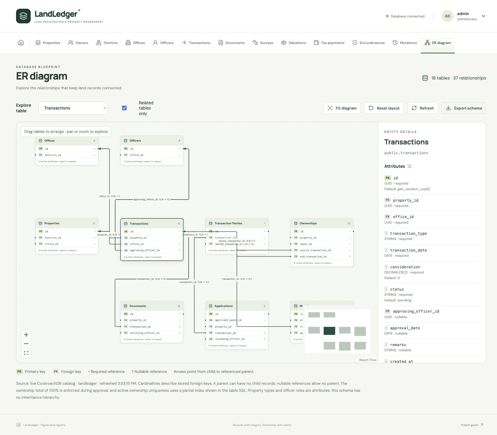

# Classroom demonstration

Use the seeded administrator account and fictional records. Do not upload real identity documents or real land deeds during the demonstration.

## 1. Show the connected database

Open Home. Explain that totals and charts are calculated from CockroachDB queries. Open any of the twelve tabs to show the corresponding records. A saved record remains after refreshing the page.

## 2. Register a new property

1. Open **Properties → Add property**. Enter a unique sample survey number, property type, area, location and boundaries. Select a district and its registration office.
2. Open the new property's record and choose **Transactions** from its shortcuts. Select **Registration**, enter a date not in the future, and save.
3. Open the transaction. Under **Transaction parties**, add a transferee with share **1**. For joint ownership, add two different transferees with **0.5** each.
4. Under **Documents**, add a **Registration deed** for this same property/transaction. Save, then upload a fictional PDF/PNG/JPEG.
5. Select a sub-registrar from the property's office and choose **Verify document**.
6. Return to the transaction, select the same office's registrar, and choose **Approve**.
7. Open the property again. Its status is Registered and the ownership history shows the transferee(s). Open the audit trail through the account menu.

The sample deed files on seeded properties are explicitly fictional and can be downloaded to demonstrate a new upload.

## 3. Transfer ownership

1. Select a registered sample property without an active encumbrance.
2. Create a **Sale**, **Inheritance**, or **Gift** transaction.
3. Add its current owner(s) as **Transferors** and the receiving owner(s) as **Transferees**. Total outgoing and incoming shares must match.
4. Add, upload and verify the matching deed type.
5. Approve the transaction using the registrar for that office.
6. Show that the old ownership remains in history and the new ownership is current. A pending ownership-change mutation is created for review.

For a partial transfer, use **0.25** on both sides. The seller retains **0.75** and the recipient gains **0.25** when the seller previously owned the whole property.

## 4. Show useful failures

- Try to approve before verifying the uploaded deed: approval is blocked.
- Use outgoing share 1 and incoming share 0.5: approval is blocked.
- Try to transfer a property with an active mortgage/lien/dispute: approval is blocked.
- Add the same state/district pair twice: the database rejects the duplicate.
- Try to edit or replace a verified deed: the interface preserves the finalized record.

## 5. Show services and certificates

Open the account menu, then **Service applications**. Owner accounts see their own submissions. A new property submitted by an owner automatically creates a registration application.

Open **Encumbrance certificates → Add certificate**. Select a property and a date range, supply a certificate number and select the office's sub-registrar. Its snapshot includes recorded claims overlapping that period, including released claims. The resulting certificate is preserved when later claims change.

## 6. Show access roles

- Sign in as **bank@landledger.local**: ownership and encumbrance records are readable, owner private identifiers/contact details are hidden, and write controls are absent.
- Sign in as **owner@landledger.local**: unrelated parcels are not available. The owner can submit a property, a transaction, documents and service applications for accessible parcels.
- Sign in as **surveyor@landledger.local**: survey forms use the account's linked survey officer; ownership approval is unavailable.
- Sign in as **auditor@landledger.local**: records and audit activity are readable; write controls are absent.

All seeded accounts use the documented demonstration password. The linked officer accounts correspond to the Chennai office; administrator approval can select registrars from other offices.

## 7. Show transaction correctness

Run `npm run test:integration` against the local CockroachDB instance. The tests create a separate disposable database and verify:

- Ownership changes and the audit record commit together.
- An intentional late failure leaves the old ownership and pending transaction unchanged.
- Two competing sales of the same share cannot both be approved.
- Partial transfers retain valid co-ownership.

## 8. Explore the live ER diagram

Open **ER diagram**. The badge shows **18 tables · 37 relationships**. Select **Transactions** in the table selector, then enable **Related tables only** to isolate its neighbours. Drag a table, pan/zoom, inspect the selected table's columns and constraints, and choose **Fit diagram** or **Reset layout**. **Export schema** downloads the live catalogue as JSON.

Each arrow runs from the child foreign-key column to the parent key. A required foreign key has parent participation **1**; a nullable foreign key has **0..1**. In this schema the parent can have **0..N** child records. The diagram reads actual database constraints; it does not infer one-to-one relationships from partial indexes or invent inheritance hierarchies for property categories.

## Suggested explanation to the professor

“Our frontend collects and displays land-registration records through an Express API connected to CockroachDB. We chose distributed SQL because the scenario has strongly related records and concurrent registration workflows across multiple offices. The main demonstration is an atomic ownership transfer: all related ownership, transaction, mutation and audit updates succeed together or roll back together. Our single-node setup demonstrates these transaction guarantees; a separate multi-node deployment would be needed to demonstrate node-failure resilience.”
