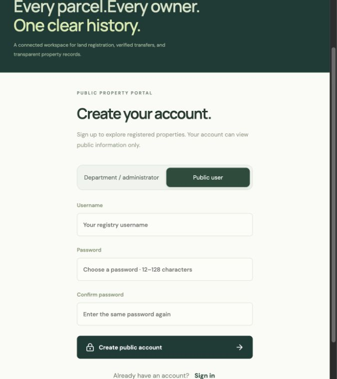
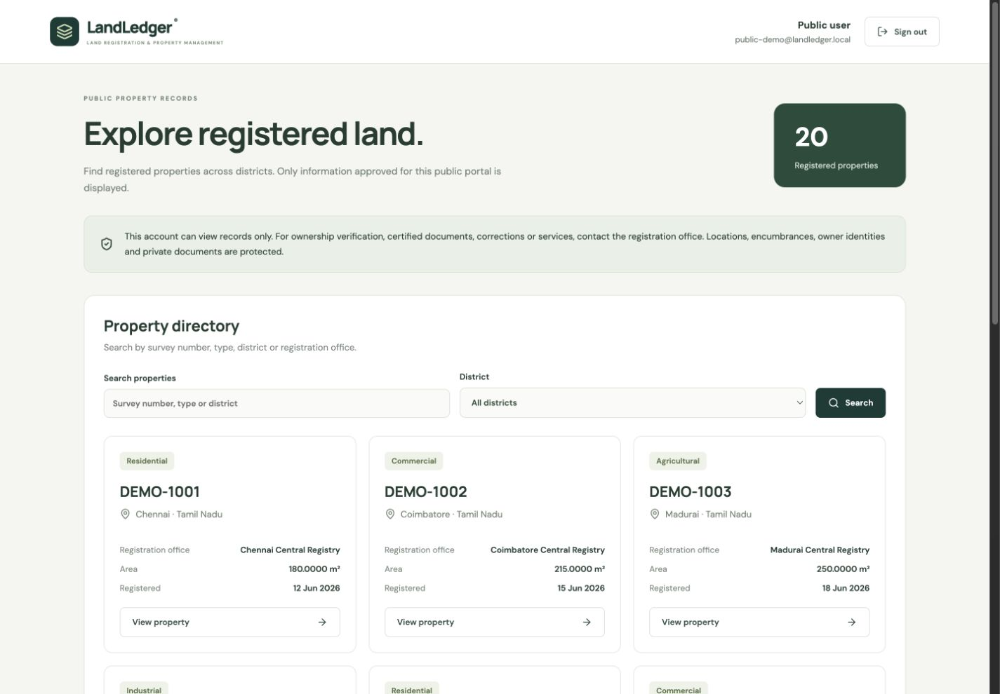

# Public signup and limited property visibility

Implemented 12 October 2026 after the user explicitly approved public self-registration, retained administrator-only creation of administrator/staff accounts, and selected a limited public directory.

## Visitor signup

On the login screen, choose **Public user → Create account**. Enter a username, choose a password of 12–128 characters, and confirm it. Successful signup opens the public portal automatically. Returning visitors select **Public user** and sign in normally.

The form has no role selector and asks for no owner identity, government ID, officer profile or ownership claim. Usernames are 3–100 letters, numbers or email characters and are normalized to lowercase. Internal `@landledger.local` identities are reserved for department/local-demo setup. An email-style username is not a verified email address or proof of property ownership.

## Administrator and staff accounts

Only a signed-in administrator can use **User accounts → Add user account** to create administrator, owner or staff accounts. Existing administrators can create additional administrators with different usernames. Owner/officer accounts still require their validated profiles.

The public signup endpoint rejects supplied `role`, `owner_id`, `officer_id`, `active`, `password_hash` and other unsupported keys. The server constructs the account with `role=public_viewer` and null owner/officer links. Changing a login button or request body cannot grant staff permissions. Public users, anonymous visitors, owners and bank accounts are denied privileged account creation by the backend.

## What public users can see

The directory only includes registered properties. It shows:

- Survey number and property type.
- Area in square metres.
- District and state.
- Registration-office name, registration date and registered status.

The internal property UUID is returned to open safe details. Registered-property counts and district filters follow the same registered-only rule.

Locations/address text, all encumbrance information, owner identities/contact details, financial records, documents, ownership/party history, pending/rejected properties, applications, staff/account records, audits and the ER diagram remain inaccessible. Location is excluded from public search as well as returned data, preventing a hidden address from being inferred by searching it. Changes to an encumbrance cannot change the public property response. Public CSV/bulk export has been removed; authorized department exports still work.

This is a limited course-project visibility policy. Parcel identifiers and area can still identify a property; the directory is not an anonymized dataset. The demo records are fictional. Use the responsible department's actual publication rules before loading real land records. Tamil Nadu's [official land-record service description](https://services.india.gov.in/service/detail/e-services-of-land-records-tamil-nadu) is an example of selected citizen access, not permission for this separate app to republish all government/private records.

## Backend and database

`POST /api/auth/signup` uses `server/signup.ts` to validate a plain JSON body, whitelist its three fields, normalize the username, protect reserved identities, bound password length and check confirmation. Passwords use the existing salted scrypt helper.

A serializable transaction inserts the public account and its self-registration audit event together. The event records the fixed role, never passwords or private input. Only after commit does the response return the safe actor fields and issue the existing signed session cookie. Duplicate usernames receive a conflict response and do not replace existing credentials. No database URL, SQL password or password hash is returned.

The signup endpoint has a separate limit of 20 attempts per 15 minutes per IP; reaching it does not exhaust sign-in's limit. Existing request-header/origin controls, body-size limits and safe error handling apply. Public-data authorization remains a deny-by-default guard and an explicit SQL projection, with parameterized search/filters and bounded pagination. Removing export reduces convenient bulk access; it does not prevent someone manually copying visible records.

No database schema change was made for signup or the tighter directory. Both use the previously approved `users` and `audit_events` tables and `public_viewer` role. The model remains **18 tables and 37 foreign keys**. No new environment variables, mail service or storage service are required.

## Verification

**79 automated tests passed: 25 unit and 54 real CockroachDB/API integration cases.** The production build passed and the installed dependency audit reported zero known vulnerabilities at check time.

Added coverage verifies normalized usernames and exact Unicode passwords; bounds/confirmation; malformed/prototype/privileged payload rejection; reserved department usernames; salted hashes; secret-free audits; automatic authenticated public sessions; duplicate conflicts; fixed role/profile values; denied private-data/schema/account access; administrator-created additional admins; denied anonymous/public/owner/bank privileged creation; CSRF/origin controls; and independent signup throttling. Existing registration, concurrency, rollback, relationship and security checks still pass. Directory assertions now require exactly the allowed fields, reject hidden location/claim filters, verify hidden-location search returns no results, and prove claim changes cannot change public details.

Browser checks verified the visible signup link, confirmed-password field, no role selector, correct field bounds, public login and limited property details. The public directory has no export button and no fixture address text. Desktop and mobile layouts stayed within their viewport widths. Account creation/session behavior was exercised by isolated API tests; no real cloud visitor account was created during browser testing.

Evidence: `docs/evidence/signup-unit-tests.tap`, `signup-integration-tests.tap`, `signup-build.txt`, `signup-dependency-audit.json` and `signup-browser-check.json`. These are representative regression checks, not exhaustive fuzzing or an independent security certification. Email verification, password-reset emails and CAPTCHA were not introduced.

## Render and local demo

Render's existing deployment settings remain valid. Push the update to `main`, then let auto-deploy complete or use **Manual Deploy → Deploy latest commit**. Refresh the hosted page and choose **Public user → Create account**. The cloud database continues to store accounts and records; no cloud credentials need to be pasted into the frontend.

Localhost uses the separate local CockroachDB populated by `npm run db:seed`, which creates fictional parcels, owners, staff and role accounts. The currently available local demo is `http://127.0.0.1:3006/`; choose **Department / administrator**, username `admin@landledger.local`, password `LandLedger@2026`. This published demonstration password is for the local dataset; your Render administrator uses the private password chosen through `db:admin`. For a normal fresh local launch, follow the README's setup and `npm run dev` instructions.
