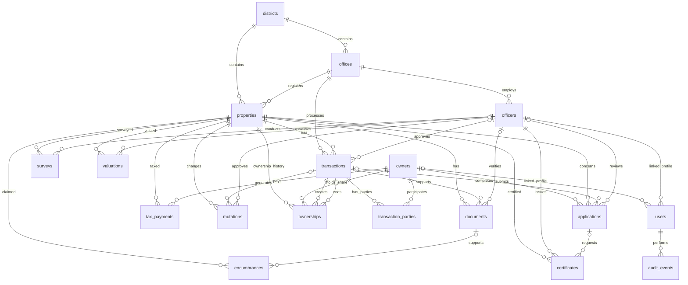

# Approved entity relationship model

The initial design contains twelve primary entities and six supporting entities. The supporting tables appear inside record details and workspace tools; they do not add six more primary navigation tabs.

## Design rules

- UUIDs are internal identifiers. Survey numbers and document/receipt/office/certificate numbers are readable business identifiers.
- Owner identification numbers are strings. District uniqueness is scoped to state.
- Primary and foreign keys prevent orphan records; historical data is not cascade-deleted.
- Money is `DECIMAL(18,2)`. Area is `DECIMAL(18,4)` in square metres. Ownership shares are `DECIMAL(9,8)` fractions.
- A registered property has current ownership shares totalling exactly one. This is a cross-row invariant, validated by the approval workflow rather than a single-row `CHECK` constraint.
- Ownership periods use `valid_from` inclusive and `valid_to` exclusive. An empty `valid_to` indicates current ownership. A partial transfer closes the affected owner's previous holding and opens a record for any remaining share. Unaffected co-owners retain their current period.
- The initial registration has transferees only. Sales, gifts and inheritance have transferors/transferees with matching total shares. Same-owner transferor/transferee entries are rejected.
- Only the controlled approval workflow changes registered ownership. Generic record updates cannot set approval or verification status.
- Approval requires a verified, uploaded matching deed, matching processing office, valid current ownership, and no active mortgage, lien or dispute.
- Officer designation and office jurisdiction are checked in the backend. A foreign key to the officers table alone does not establish authorization.
- Completed surveys and valuations are retained as historical records. A completed survey updates the property's latest area/boundaries; its survey row preserves the measurement.
- Approved/rejected transactions, finalized documents, certificates and completed records cannot be arbitrarily edited/deleted through the API.
- Certificates store a JSON snapshot of all recorded claims overlapping the requested period. Individual claims and issued certificates are different entities.
- Audit summaries store operation names and field names, not raw identity numbers, passwords or document contents.

The executable definition is in `server/schema.sql`. The [approval record](SCHEMA_APPROVAL.md) records why the missing fields/supporting tables were introduced.

## Public-user account update

Approved through the follow-up request to implement and explain the changes. The existing `users.role` check now includes `public_viewer`; the profile check permits that role only with `owner_id IS NULL AND officer_id IS NULL`. These two checks have explicit names, `users_role_allowed` and `users_role_profile`. `server/upgrade-public-role.ts` upgrades the original generated checks after validating their replacements. All existing rows, column definitions, tables and 37 foreign keys are preserved. Public access uses backend projections, not new database entities.

## Officer access follow-up — 20 October 2026

The requested account/profile links now include bank verifiers. `officers.designation` accepts `bank_verifier`; `users_role_profile` permits that role’s existing `officer_id` foreign key, while temporarily tolerating null links on legacy bank accounts. New bank accounts require a matching active profile in the API. The migration preserves the 18 tables and 37 foreign keys. Jurisdiction snapshots use the existing audit summary JSON, and account removal retains identities referenced by the audit trail. [Role access](ROLE_ACCESS.md) describes the associated scopes and workflow rules.
